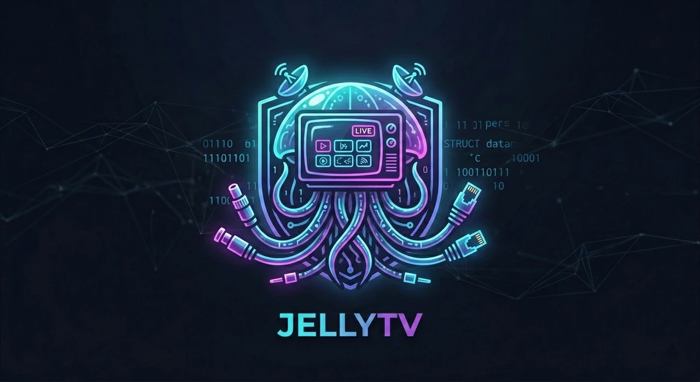

<div align="center">

<br>

🌐 &nbsp;[**Español**](README.md)&nbsp; · &nbsp;**English**

<br>



**Jellyfin plugin** that turns your IPTV channels into a **native Live TV provider**:
Direct, FAST and Tokenized, with automatic token renewal, backup sources and an automatic EPG guide —
**no external tuner and no transcoding**.

<br>

[](https://github.com/BORNIOS/JellyTV/commits/main)
[](https://github.com/BORNIOS/JellyTV/actions/workflows/build.yaml)
[](https://jellyfin.org)
[](https://github.com/BORNIOS/JellyTV/releases)
[](LICENSE)

</div>

---

## 🧭 What is JellyTV?

If you subscribe to internet TV services (IPTV), every channel is a web address, and those addresses tend to be awkward: some change every few minutes, others hide the video behind a web page and others carry a temporary code (token) that expires. **JellyTV is the middleman**: Jellyfin asks it for the channel, the plugin finds it, keeps it alive and hands it over. Channels show up in Jellyfin's **Channels** section like any TV channel, on web, mobile, Android TV, etc.

---

## ✨ Features

- 📡 **Native Live TV provider** — your channels show up straight in *Channels* on every client. **No external M3U tuner needed**.
- 🔀 **Three channel types**: **Direct**, **FAST** and **Tokenized**, managed one by one from the settings.
- 🔑 **Automatic tokens** — if your provider rotates the URL or uses token pages (redirects, iframes or an `.m3u8` embedded in the HTML), JellyTV finds it and **keeps the token fresh** (reactive renewal on 401/403 and, for ephemeral tokens, ahead of expiry). Any tokenized `.m3u8` found in the page is taken as the official stream.
- ⏱️ **«Session token» mode** — for providers that issue a token valid for the **whole session**: JellyTV resolves it once and shares it across all clients, with no needless renewals.
- 🛡️ **Several sources per channel (backups)** — each channel can have several sources; the plugin checks which are alive, **switches to the next live one on its own** and shows the health of **each source** separately.
- ⚡ **No transcoding** — the relay rewrites HLS and serves segments from memory; video is never written to disk or re-encoded.
- 📺 **Automatic EPG guide** — identifies your channels in iptv-org and finds their guide on its own; your own XMLTV sources and per-channel guide pages work too.
- 🪪 **Channel identity from iptv-org** — fills country, `tvg-id`, logo and website without overwriting what you typed.
- 🎬 **Optional TMDB enrichment** — titles, descriptions and year for the programmes in your guide.
- 📋 **M3U playlist for external apps** (IPTV Smarters, IPVIO, VLC…) always through the relay, with a copy button.
- 🧩 **Optional proxies** — for providers that block your IP or country-restricted channels.
- 📚 **FAST provider catalog** — imports channels from Pluto TV, Plex, Tubi and Runtime straight from their API; a channel you already have is added as a backup.
- 🌐 **Spanish and English panel** — follows your Jellyfin user language.
- 🖥️ **Admin panel** — tables with search and sorting (alphabetical by default), per-channel editor, health, guide coverage, diagnostics and log.

---

## ⚙️ Requirements

| | |
|---|---|
| **Server** | Jellyfin 12.1+ (built against `Jellyfin.Controller` **12.1.0**, .NET 10; tested on 12.4) |
| **IPTV channels** | HLS (`.m3u8`) or MPEG-TS URLs from your providers |
| **TMDB** *(optional)* | Free API key from [themoviedb.org](https://www.themoviedb.org/settings/api) to enrich the guide |
| **EPG sources** *(optional)* | Your own XMLTV URLs, on top of the automatic guide |

> ✅ JellyTV works **standalone** as a Live TV provider. The automatic guide, TMDB and your own EPG sources are optional.

### Known limits

- **Not supported**: **DASH (`.mpd`)** streams, **progressive MP4** and **DRM**-protected content (Widevine/PlayReady). The relay works with HLS and MPEG-TS.
- A **Direct** channel through the relay (M3U playlist or exit country) uses the server's **upload** bandwidth.
- Some providers answer 403 to requests that do not come from a browser; those channels may not resolve.

---

## 🚀 Installation

### Option A — From the repository (recommended)

1. In Jellyfin go to **Dashboard → Advanced → Plugin repositories**.
2. Click **Add repository** and use the **manifest** URL:

   ```
   https://raw.githubusercontent.com/BORNIOS/JellyTV/main/manifest.json
   ```
3. Save, open **Catalog**, find **JellyTV** and **Install**.
4. Restart Jellyfin if asked and add your channels under **Dashboard → Plugins → JellyTV**.

### Option B — Manual

1. Download the latest version from [**Releases**](https://github.com/BORNIOS/JellyTV/releases).
2. Create a `JellyTV` folder inside your installation's plugins directory and extract the ZIP there
   (it contains only `Jellyfin.Plugin.JellyTV.dll`).
3. Restart Jellyfin.
4. Go to **Dashboard → Plugins → JellyTV** and add your channels.

> 💡 Common plugin directory locations:
> - **Linux / Docker:** `/config/plugins/`
> - **Windows:** `%LOCALAPPDATA%\jellyfin\plugins\`

---

## 🛠️ Configuration

Under **Dashboard → Plugins → JellyTV** everything is managed with tabs:

| Tab | What is there |
|---|---|
| **Overview** | General status, **channel health** (manual check with a progress bar, includes switched-off channels; a switched-off channel found alive is turned on automatically) and *Quick access*: copy the M3U playlist and the guide URL; diagnostics (sessions and log) |
| **Channels** | Channel table and per-channel editor: name, type, **backup sources**, logo, `tvg-id`, country, category, User-Agent and headers, identity and own guide |
| **Catalog** | **Pluto TV, Plex, Tubi and Runtime** channels queried straight from each provider, in one accordion per provider so you tick only the ones you want to import |
| **EPG guide** | XMLTV sources, sync with a progress bar, per-channel coverage and which source was each channel's primary |
| **Proxies** | Proxies by country, with status |
| **Settings** | How channels reach Live TV, public URL, User-Agent, TMDB, automatic guide, HTML guide recipes, time zone, scheduled tasks and storage |

### Source types

| Type | When to use it | What the plugin does |
|---|---|---|
| 🟢 **Direct** | The URL is already the final stream and answers 200 | Delivered as-is, without going through the relay |
| 🔵 **FAST** | Public (HLS) channel with no authentication | Strips beacons and ads from the playlist and serves segments through the relay |
| 🟠 **Tokenized** | The URL is a page/gateway that returns or redirects to an `m3u8?token=…` | Follows redirects, meta-refresh, **iframes** and the `m3u8` embedded in the HTML, and renews the token |

The **Session token** check only appears on **Tokenized** sources: it says the token is valid for the whole session. Each source can also have an **exit country** (downloaded through a proxy of that country); the channel can have its own **User-Agent and headers**.

### «Dirty» channels (gateway → iframe → m3u8)

Example: `https://gateway.example/online.php?stream=channel` returns HTML with an `iframe`, and that page serves `mono.m3u8?token=…`. The plugin:

1. Follows HTTP redirects and `meta refresh`.
2. If there is no `m3u8`, follows the **player iframe** (never beacons, ads or popups).
3. Extracts the `m3u8` embedded in the HTML or JavaScript; if there are several, it **prefers the one carrying a token**.
4. Retries with the site's own `Referer` when the gateway answers **403** without it.
5. Rewrites the playlist to the relay and **removes** ad markers (`#EXT-X-DATERANGE`, `#EXT-X-CUE-*`, SCTE-35…).

---

## 📡 How each channel reaches your clients

### In Jellyfin (native service)

| Source type | Delivery | Why |
|---|---|---|
| **Direct** | Provider URL | Real Direct Play: no relay, no remux |
| **Direct with exit country** | Relay (through a proxy of that country) | The device cannot reach the blocked origin |
| **Direct with a huge DVR window** | Relay (trimmed to ~60 s of live) | Some providers publish hours of DVR (e.g. 12 h = 10,800 segments, ~460 KB per reload) and browsers start slowly. It is detected by the health check: until one runs, the channel stays direct |
| **Tokenized** (session or ephemeral) | Relay | The provider ties the token to the IP that requested it (the server); a client with another IP would get 403 |
| **FAST** | Relay with cleaning | Beacons and ads are stripped and the DVR window is trimmed |

- **Session token:** the plugin resolves it **just once** and shares it across all clients (reused for about 10 minutes and refreshed ahead of time).
- **Ephemeral token:** **one consumer per channel**: a background worker renews the token and downloads each segment once; clients read from memory. With 1 or 1,000 viewers the provider sees the same requests.
- The relay **trims** playlists with huge DVR windows (e.g. 10,800 segments) down to ~60 s of live, so Jellyfin receives a small, normal list.
- The relay **does not use ffmpeg** (only the health check uses it, to verify that a channel plays).
- Jellyfin flags the video of any plugin Live TV service as interlaced; JellyTV fixes the PlaybackInfo response to offer Direct Play when the client profile accepts HLS/h264/aac.

### Playlist for external clients (IPTV Smarters, IPVIO, VLC…)

Besides the native service, JellyTV exposes an M3U playlist and an XMLTV guide for non-Jellyfin apps:

| Resource | URL |
|---|---|
| Playlist | `https://your-server/JellyTV/m3u?key=<RelayKey>` (alias `tuner.m3u`) |
| Guide | `https://your-server/JellyTV/epg.xml` |

- **Always through the relay**: every channel (Direct, FAST and Tokenized) is emitted as `/JellyTV/stream.m3u8?…&relay=1`; the playlist **never** contains the provider URL. Clients need no token logic or knowledge of the origin, and the `.m3u8` extension lets ExoPlayer and similar players detect HLS.
- **Stale-list tolerant**: if a client saved an old playlist, the relay serves the channel's current active source.
- **No caching**: the response carries `Cache-Control: no-store`, but many apps store the list locally; set their refresh (on start / every X hours) or reload it after changing channels.
- **Copying the URLs**: *Overview → Quick access* has a **Copy** button for the playlist and one for the guide. They use the *Public streaming URL* from Settings when set; otherwise the address you used to open Jellyfin.
- The playlist URL includes the **RelayKey**: treat it as a secret.

### Live TV: native service or M3U tuner

- **Automatic (recommended)**: Jellyfin takes channels and guide straight from the plugin's native service. If you already registered an M3U tuner pointing to `/JellyTV/tuner.m3u`, it is migrated so channels are not duplicated.
- **Native JellyTV service**: forces the native service (no playlist).
- **M3U tuner only** *(legacy)*: you register `/JellyTV/tuner.m3u` as an M3U Tuner and `epg.xml` as XMLTV. Jellyfin 12's stock M3U tuner does not Direct Play `.m3u8` manifests, so Jellyfin transcodes them; that is why it is not recommended.

The mode is selected in **Settings → How channels reach Live TV**.

---

## 📚 FAST provider catalog

The **Catalog** tab imports free channels (Pluto TV, Plex, Tubi and Runtime) **with no middlemen**: the plugin asks each provider through the same API its website uses, not third-party lists.

1. Open a provider in the accordion: its catalog is fetched (remembered for 15 minutes).
2. Tick the channels you want. Ones you already imported show as *Imported*, and ones whose name matches a channel you already have show as *You already have one like it* (many channels live in several providers).
3. If a channel matches one you already have by name, ticking it changes its badge to **"Will be added as a backup"**: instead of creating another channel, the provider's one is added as a **backup source** of that channel, which keeps its main source, its guide and its identity.
4. **Import**: each channel is created as **FAST** with its logo, category and `tvg-id` (the channel id at the provider). Each provider's categories are reduced to Jellyfin's (**Movies, Series, Kids, News, Sports**) plus **Music** and **General**, so the list does not fill up with micro categories, and the **provider's guide** is added to the EPG sources. Sync the guide to see the schedule.

How they play: the channel does not store a URL with a token but an internal address (`jtv-provider://…`) that the plugin turns into the real URL **every time it opens the channel**, with its current token; if the provider rejects the token (401/403) it renews it. These channels' guide is also built from the provider's API.

| Provider | How it is queried | Catalog |
|---|---|---|
| **Pluto TV** | `boot.pluto.tv` (session with a ~24 h JWT) and `service-channels.clusters.pluto.tv` | By IP (LATAM from Mexico) |
| **Plex** | Anonymous token from `clients.plex.tv` and `epg.provider.plex.tv` | By IP (278 channels from Mexico) |
| **Tubi** | `tubitv.com/live` and `oz/epg/programming`, no account | By IP: only a few channels from Mexico; the US one is much larger |
| **Runtime** | Its website's API (`api-ott.runtime.tv`) with the public token the page gives every visitor; no account | ~40 linear channels of film, series and partners; some only in certain countries |

- **Geoblocking:** the provider picks the catalog by the IP of whoever asks, that is, the server's. The *Query the catalogs from* selector uses an exit proxy of another country (**Proxies** tab); imported channels remember that exit country and download through that proxy.
- These services' addresses and APIs are neither official nor stable: if a provider changes theirs, that provider stops working until the plugin is updated. The health check flags it.
- Providers are added as code (one class per provider); Samsung TV Plus, LG Channels and Canela TV are not there yet. Roku and ViX were ruled out: their streams are DRM-encrypted (Widevine) and cannot go through the relay.

## 🪪 Channel identity (iptv-org)

Each channel can be identified in the [public iptv-org database](https://github.com/iptv-org/database) (Unlicense; covers TV, web and FAST channels). With the identity the plugin **fills whatever the channel lacks**: country, `tvg-id`, logo and website. It never overwrites what you typed.

- **Search identity** (channel form) proposes candidates. If the channel's `tvg-id` matches a database id (e.g. `ESPN.us`), that match wins.
- **Your local guides count as candidates too.** Pluto, Samsung, Plex or Tubi do not use a `tvg-id` but their own channel id: when the guide syncs, the plugin saves the channel list of every source you added by hand, and *Search identity* offers them with their logo ("guide Plex"). Picking one copies its id into the channel's `tvg-id`. Nothing is applied automatically.
- **Complete identity and logos** (Channels tab) does it in bulk and only applies exact matches; if the name exists in several countries (e.g. `ESPN` in US, BR, AU) and the channel has no country, it **does not guess** and leaves it untouched. Anything you confirm by hand is never overwritten.
- The iptv-org data is three public JSON files (`channels.json`, `logos.json` and `guides.json`, about 5 MB downloaded compressed, ≈40 MB uncompressed) that only describe channels; they **contain no programme listings** (those come from the guide, below). The plugin keeps a reduced copy as a cache in **Jellyfin's cache folder** (`<cache>/JellyTV/iptvorg.json`) for 7 days, so it is not downloaded on every use. It is disposable (if deleted it is downloaded again on its own) and independent of the storage backend (PostgreSQL or JSON). No keys are needed.

> Logos are trademarks of their broadcasters: JellyTV only stores the **link**, never copies or redistributes it.

---

## 🗓️ EPG guide

The guide the plugin serves (`/JellyTV/epg.xml`, and the one Jellyfin sees) is built on every sync from several sources. All are optional and combine: per channel, the plugin picks the source that covers it best and uses the others to fill gaps.

### Automatic guide (default)

Can be turned off in **Settings → Automatic guide**. It looks up the guide of identified channels on its own:

1. **Identifies** in iptv-org the channels that still lack country, `tvg-id` or logo.
2. **Downloads the public per-country XMLTV files** for your channels' countries (one file per country from [iptv-epg.org](https://iptv-epg.org/), whose channel ids follow the same `Name.country` scheme as iptv-org; a country missing there falls back to [epgshare01.online](https://epgshare01.online/epgshare01/). The file list is read from their indexes, not hardcoded) and filters them to your channels: by `tvg-id` first, then by name and country (it ignores parenthesised text, like "Canal TUDN (México)").
3. **Fills the rest from GatoTV**: channels no file covered and that iptv-org links to a gatotv.com channel page get that page as their own guide, only during the sync.

Automatic sources are not saved in the configuration (they are computed on every sync) and are named "Automática · epg-XX.xml.gz". If you already configured the same file (e.g. `epg-mx.xml`) it is not downloaded twice.

> ⚠️ **Size:** the files cover a whole country. The US one is about 60 MB compressed (≈520 MB uncompressed); Mexico's is about 1.6 MB. The plugin downloads the file and keeps only your channels. To avoid the large download you can turn the automatic guide off or use iptv-epg.org's *Combine* feature (needs an account) and add its private link as a source.

### Your own sources

- **XMLTV sources** (*EPG guide* tab): any XMLTV file, filtered to your channels. The ones you add go first.
- **Own guide per channel** (channel form): a guide URL; if it is a web page it is read with a **recipe** (the `gatotv.com` one is built in and you can add others in Settings). Use **Test guide** before saving.
- **Time zone** (Settings): for XMLTV with times that have no offset.

### TMDB enrichment (optional)

With a TMDB credential the plugin completes title, overview and year of the programmes.

The **EPG guide** tab shows per-channel **coverage** (how many programmes, until when, which source was the primary) and the **sources**.

---

## 💾 Storage (PostgreSQL or JSON)

Channels, proxies and EPG sources live in a backend selectable from **Settings → Storage**:

| Backend | When to use it |
|---|---|
| **Automatic** (default) | Uses PostgreSQL if the [**PostgreSQL Database Provider**](https://github.com/BORNIOS/Jellyfin-Database-Providers-Postgres) plugin is installed; otherwise JSON files |
| **PostgreSQL** | Forces the [PG Provider](https://github.com/BORNIOS/Jellyfin-Database-Providers-Postgres)'s private `jellytv_<guid>` schema (never touches `public`); falls back to JSON if unavailable |
| **JSON files** | Forces `channels.json`, `proxies.json` and `epg-sources.json` in the data folder; nothing else to install |

The JSON folder can be changed with **JSON files folder** (absolute paths only; a relative one is ignored). With **Write a JSON copy even when PostgreSQL is active** the plugin also keeps a readable copy of the same data, useful for migrating or going back to files without relying on the [PG Provider](https://github.com/BORNIOS/Jellyfin-Database-Providers-Postgres).

The plugin's XML configuration is kept as a mirror, so switching backends loses nothing: on startup it is hydrated from the active backend and, if that is empty, seeded from the XML configuration. A backend change applies when Jellyfin restarts.

The full model — tables, channel↔backup relations, indexes, failover flow and retention — is in [docs/SCHEMA.md](docs/SCHEMA.md). The **TMDB API key** stays in Jellyfin's XML configuration: it is never written to the database or the JSON copy.

---

## 🔌 Internal API

| Endpoint | Description |
|---|---|
| `GET /JellyTV/m3u` (`tuner.m3u`) | M3U playlist for external clients, all through the relay (`?key=`) |
| `GET /JellyTV/epg.xml` | XMLTV guide |
| `GET /JellyTV/stream.m3u8?url=…` | Opens a channel through the relay (the `.m3u8` extension helps players) |
| `GET /JellyTV/stream?url=…` | Same, without the extension |
| `GET /JellyTV/segment?sid=…&url=…` | Segment proxy |
| `GET /JellyTV/channels` | Channels health status *(admin)* |
| `POST /JellyTV/health-check` | Manual background health check *(admin)* |
| `GET /JellyTV/providers`, `/providers/{id}/channels` | Catalog providers and their channels *(admin)* |
| `POST /JellyTV/providers/{id}/import` | Imports catalog channels; duplicates become backups *(admin)* |
| `POST /JellyTV/refresh-guide` | Re-sync the EPG guide *(admin)* |
| `GET /JellyTV/sessions`, `/log`, `/metrics` | Diagnostics *(admin)* |
| `GET /JellyTV/storage` | Active storage backend *(admin)* |

---

## ❓ FAQ

<details>
<summary><b>Do I need an external M3U tuner or a separate playlist?</b></summary>

No. JellyTV registers a **native Live TV provider**; your channels appear directly under
*Channels*. For non-Jellyfin apps use the playlist from `/JellyTV/m3u` (see *Playlist for external clients*).
</details>

<details>
<summary><b>Does it transcode or store the video?</b></summary>

No. The plugin **does not transcode or write video to disk**: it relays the provider stream (segments
pass through memory). If Jellyfin transcodes a channel, it is usually because the client does not accept
the format; check the reason in Jellyfin's playback panel.
</details>

<details>
<summary><b>My provider changes the token every few minutes — does the channel drop?</b></summary>

JellyTV renews the token **ahead of expiry** and **reactively** (if a segment answers 401/403).
Interruptions are minimized; if the provider invalidates by IP or concurrency, the plugin
mitigates the impact with retries and backoff.
</details>

<details>
<summary><b>What is a «session token»?</b></summary>

Some gateways return a token valid for the **whole session** (an `.m3u8` signed for hours).
With **session token** enabled, JellyTV resolves the token once, shares it across all clients and
does **not** renew it proactively; if the provider answers 401/403 it asks for it again.
</details>

<details>
<summary><b>A channel has several sources — which one is used?</b></summary>

The first enabled source the health check marks as alive. If a source fails when the channel is opened,
the plugin tries the next one and remembers the one that worked. The **Health** column in the Channels tab and the
channel editor show which source is alive and which is down (with its last error). If all are down, the channel is marked as down.
</details>

<details>
<summary><b>Is the TMDB key mandatory?</b></summary>

No. JellyTV works as a Live TV provider **without it**; TMDB only adds overviews and year to the guide.
</details>

<details>
<summary><b>My provider blocks my server's IP — what do I do?</b></summary>

Set up a **proxy** in the Proxies tab (with its country) and, on the channel's source, choose that **exit country**:
JellyTV will download that source through a proxy of that country (round-robin, with a cooldown for a failed proxy).
Proxies are also used when resolving the chain of a tokenized channel.
</details>

<details>
<summary><b>Why does a DASH (.mpd), MP4 or DRM channel not play?</b></summary>

The relay only works with HLS and MPEG-TS. DRM-encrypted content cannot be played and JellyTV
does not include, and will not include, any way to decrypt it.
</details>

---

## 🧑‍💻 Development

Project aligned with the [official Jellyfin plugin template](https://github.com/jellyfin/jellyfin-plugin-template)
(analyzers, CI and manifest). Style analyzers are treated as build errors.

```bash
# Build (Release)
dotnet build Jellyfin.Plugin.JellyTV.sln -c Release

# Publish the DLL
dotnet publish Jellyfin.Plugin.JellyTV/Jellyfin.Plugin.JellyTV.csproj -c Release -o publish

# Regression tests (HLS, tokens, guides, providers and panel i18n)
dotnet run --project tests/JellyTV.HlsRegression -c Release -p:RunAnalyzers=false

# Including a check against the real public services (needs network)
dotnet run --project tests/JellyTV.HlsRegression -c Release -p:RunAnalyzers=false -- --live
```

**Config panel.** It is written as pieces under `Jellyfin.Plugin.JellyTV/Configuration/Page/` (`page.html`, `page.css`, `i18n.js`, `app.js`) and the build joins them into the single `configPage.html` Jellyfin serves. Source text is Spanish; the English translations live in `i18n.js` and a regression test fails if one is missing.

---

## 📄 License

This project is distributed under the **GPL-3.0**. See the [`LICENSE`](LICENSE) file.

> **Disclaimer:** JellyTV is not affiliated with Jellyfin, iptv-org or The Movie Database (TMDB). Use it only with
> providers and content you have the necessary rights to.
