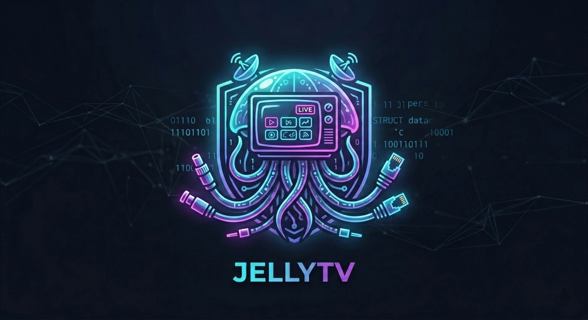

<div align="center">

<br>

🌐 &nbsp;**Español**&nbsp; · &nbsp;[**English**](README.en.md)

<br>



**Plugin para Jellyfin** que convierte tus canales IPTV en un **proveedor nativo de Live TV**:
Directo, FAST y Tokenizado, con renovación automática de tokens, fuentes de respaldo y guía EPG automática,
**sin tuner externo y sin transcodificar**.

<br>

[](https://github.com/BORNIOS/JellyTV/commits/main)
[](https://github.com/BORNIOS/JellyTV/actions/workflows/build.yaml)
[](https://jellyfin.org)
[](https://github.com/BORNIOS/JellyTV/releases)
[](LICENSE)

</div>

---

## 🧭 ¿Qué es JellyTV?

Si contratas servicios de TV por internet (IPTV), cada canal es una dirección web, y esas direcciones suelen ser incómodas: algunas cambian cada pocos minutos, otras esconden el video detrás de una página web y otras llevan un código temporal (token) que caduca. **JellyTV hace de intermediario**: Jellyfin le pide el canal, el plugin lo busca, lo mantiene vivo y se lo entrega. Los canales aparecen en la sección **Canales** de Jellyfin como cualquier canal de TV, en web, móvil, Android TV, etc.

---

## ✨ Características

- 📡 **Proveedor nativo de Live TV** — tus canales aparecen directamente en *Canales* de todos tus clientes. **No necesitas un tuner M3U externo**.
- 🔀 **Tres tipos de canal**: **Directo**, **FAST** y **Tokenizado**, gestionados uno a uno desde la configuración.
- 🔑 **Tokens automáticos** — si tu proveedor rota la URL o usa páginas con token (redirecciones, iframes o un `.m3u8` embebido en el HTML), JellyTV lo encuentra y **mantiene el token fresco** (renovación reactiva ante 401/403 y, en tokens efímeros, anticipada). Cualquier `.m3u8` con token encontrado en la página se toma como la transmisión oficial.
- ⏱️ **Modo «token de sesión»** — para proveedores que emiten un token válido **toda la sesión**: JellyTV lo resuelve una vez y lo comparte entre todos los clientes, sin renovaciones innecesarias.
- 🛡️ **Varias fuentes por canal (respaldos)** — cada canal puede tener varias fuentes; el plugin comprueba cuáles están vivas, **conmuta solo a la siguiente viva** y te muestra la salud de **cada fuente** por separado.
- ⚡ **Sin transcodificar** — el relay reescribe el HLS y entrega los segmentos desde memoria; el video no se guarda en disco ni se re-codifica.
- 📺 **Guía EPG automática** — identifica tus canales en iptv-org y busca solos su guía; además admite tus propias fuentes XMLTV y páginas de guía por canal.
- 🪪 **Identidad de canal con iptv-org** — completa país, `tvg-id`, logo y sitio web sin pisar lo que escribiste.
- 🎬 **Enriquecimiento TMDB opcional** — títulos, descripciones y año para los programas de tu guía.
- 📋 **Playlist M3U para apps externas** (IPTV Smarters, IPVIO, VLC…) siempre por el relay, con botón de copiar.
- 🧩 **Proxies opcionales** — para proveedores que bloquean tu IP o canales restringidos por país.
- 📚 **Catálogo de proveedores FAST** — importa canales de Pluto TV, Plex, Tubi y Runtime directo de su API; si ya tienes el canal, se añade como respaldo.
- 🌐 **Panel en español e inglés** — sigue el idioma de tu usuario de Jellyfin.
- 🖥️ **Panel de administración** — tablas con búsqueda y orden (por defecto alfabético), editor por canal, salud, cobertura de la guía, diagnóstico y registro.

---

## ⚙️ Requisitos

| | |
|---|---|
| **Servidor** | Jellyfin 12.1+ (compilado contra `Jellyfin.Controller` **12.1.0**, .NET 10; probado en 12.4) |
| **Canales IPTV** | URLs HLS (`.m3u8`) o MPEG-TS de tus proveedores |
| **TMDB** *(opcional)* | Clave de API gratuita en [themoviedb.org](https://www.themoviedb.org/settings/api) para enriquecer la guía |
| **Fuentes EPG** *(opcional)* | URLs XMLTV propias, además de la guía automática |

> ✅ JellyTV funciona **solo** como proveedor de Live TV. La guía automática, TMDB y las fuentes EPG propias son opcionales.

### Límites conocidos

- **No soporta** streams **DASH (`.mpd`)**, **MP4 progresivo** ni contenido con **DRM** (Widevine/PlayReady). El relay trabaja con HLS y MPEG-TS.
- Un canal **Directo** por el relay (playlist M3U o país de salida) consume ancho de banda de **subida** del servidor.
- Algunos proveedores responden 403 a peticiones que no vienen de un navegador; esos canales pueden no resolverse.

---

## 🚀 Instalación

### Opción A — Desde el repositorio (recomendada)

1. En Jellyfin ve a **Panel → Avanzado → Repositorios de plugins**.
2. Pulsa **Añadir repositorio** y usa la URL del **manifest**:

   ```
   https://raw.githubusercontent.com/BORNIOS/JellyTV/main/manifest.json
   ```
3. Guarda y ve a **Catálogo**, busca **JellyTV** e **Instala**.
4. Reinicia Jellyfin si lo solicita y añade tus canales en **Panel → Plugins → JellyTV**.

### Opción B — Manual

1. Descarga la última versión desde [**Releases**](https://github.com/BORNIOS/JellyTV/releases).
2. Crea una carpeta `JellyTV` dentro del directorio de plugins de tu instalación y extrae ahí el ZIP
   (contiene solo `Jellyfin.Plugin.JellyTV.dll`).
3. Reinicia Jellyfin.
4. Ve a **Panel → Plugins → JellyTV** y añade tus canales.

> 💡 Ubicaciones comunes del directorio de plugins:
> - **Linux / Docker:** `/config/plugins/`
> - **Windows:** `%LOCALAPPDATA%\jellyfin\plugins\`

---

## 🛠️ Configuración

Desde **Panel → Plugins → JellyTV** gestionas todo con pestañas:

| Pestaña | Qué hay |
|---|---|
| **Resumen** | Estado general, **salud de canales** (verificación manual con barra de progreso, incluye los canales apagados; un canal apagado que resulta estar vivo se enciende solo) y *Acceso rápido*: copiar la playlist M3U y la URL de la guía; diagnóstico (sesiones y registro) |
| **Canales** | Tabla de canales y editor por canal: nombre, tipo, **fuentes de respaldo**, logo, `tvg-id`, país, categoría, User-Agent y cabeceras, identidad y guía propia |
| **Catálogo** | Canales de **Pluto TV, Plex, Tubi y Runtime** consultados directamente en cada proveedor, en un acordeón por proveedor para marcar solo los que quieres importar |
| **Guía EPG** | Fuentes XMLTV, sincronización con barra de progreso, cobertura por canal y qué fuente fue la principal de cada uno |
| **Proxies** | Proxies por país, con estado |
| **Ajustes** | Cómo llegan los canales a Live TV, URL pública, User-Agent, TMDB, guía automática, recetas de guía HTML, zona horaria, tareas programadas y almacenamiento |

### Tipos de fuente

| Tipo | Cuándo usarlo | Qué hace el plugin |
|---|---|---|
| 🟢 **Directo** | La URL ya es el stream final y responde 200 | Se entrega tal cual, sin pasar por el relay |
| 🔵 **FAST** | Canal público (HLS) sin autenticación | Limpia beacons y anuncios de la playlist y sirve los segmentos por el relay |
| 🟠 **Tokenizado** | La URL es una página/gateway que entrega o redirige a un `m3u8?token=…` | Resuelve redirecciones, meta-refresh, **iframes** y el `m3u8` embebido en el HTML, y renueva el token |

El check **Token por sesión** solo aparece en fuentes **Tokenizado**: indica que el token vale toda la sesión. Cada fuente puede además tener un **país de salida** (se descarga por un proxy de ese país); el canal puede tener **User-Agent y cabeceras** propios.

### Canales «sucios» (gateway → iframe → m3u8)

Ejemplo: `https://gateway.example/online.php?stream=canal` devuelve HTML con un `iframe`, y esa página entrega `mono.m3u8?token=…`. El plugin:

1. Sigue redirecciones HTTP y `meta refresh`.
2. Si no hay `m3u8`, sigue el **iframe del reproductor** (nunca beacons, anuncios ni ventanas emergentes).
3. Extrae el `m3u8` embebido en el HTML o en JavaScript; si hay varios, **prefiere el que lleva token**.
4. Reintenta con `Referer` del propio sitio cuando el gateway responde **403** sin él.
5. Reescribe la playlist al relay y **elimina** marcas de anuncio (`#EXT-X-DATERANGE`, `#EXT-X-CUE-*`, SCTE-35…).

---

## 📡 Cómo llega cada canal a tus clientes

### En Jellyfin (servicio nativo)

| Tipo de fuente | Entrega | Motivo |
|---|---|---|
| **Directo** | URL del proveedor | Direct Play real: sin relay, sin remux |
| **Directo con país de salida** | Relay (por un proxy de ese país) | El dispositivo no puede llegar al origen bloqueado |
| **Directo con ventana DVR enorme** | Relay (recorta a ~60 s de vivo) | Algunos proveedores publican horas de DVR (p. ej. 12 h = 10 800 segmentos, ~460 KB por recarga) y el navegador tarda en arrancar. Se detecta en la verificación de salud: hasta que corra una, el canal sigue directo |
| **Tokenizado** (de sesión o efímero) | Relay | El proveedor ata el token a la IP que lo pidió (el servidor); un cliente con otra IP recibiría 403 |
| **FAST** | Relay con limpieza | Se eliminan beacons y anuncios y se recorta la ventana DVR |

- **Token de sesión:** el plugin lo resuelve **una sola vez** y lo comparte entre todos los clientes (se reutiliza unos 10 minutos y se refresca de forma anticipada).
- **Token efímero:** **un solo consumidor por canal**: un proceso en segundo plano renueva el token y descarga cada segmento una vez; los clientes leen de memoria. Con 1 o con 1000 espectadores, el proveedor ve las mismas peticiones.
- El relay **recorta** playlists con ventanas DVR enormes (p. ej. 10 800 segmentos) a ~60 s de vivo, así que Jellyfin recibe una lista pequeña y normal.
- El relay **no usa ffmpeg** (solo el health check lo emplea para comprobar que un canal reproduce).
- Jellyfin marca como entrelazado el vídeo de cualquier servicio Live TV de plugin; JellyTV corrige la respuesta de PlaybackInfo para ofrecer Direct Play cuando el perfil del cliente acepta HLS/h264/aac.

### Playlist para clientes externos (IPTV Smarters, IPVIO, VLC…)

Además del servicio nativo, JellyTV expone una playlist M3U y una guía XMLTV para apps que no son Jellyfin:

| Recurso | URL |
|---|---|
| Playlist | `https://tu-servidor/JellyTV/m3u?key=<RelayKey>` (alias `tuner.m3u`) |
| Guía | `https://tu-servidor/JellyTV/epg.xml` |

- **Siempre por el relay**: todos los canales (Directo, FAST y Tokenizado) salen como `/JellyTV/stream.m3u8?…&relay=1`; la playlist **nunca** contiene la URL del proveedor. Así el cliente no necesita resolver tokens ni conocer el origen, y la extensión `.m3u8` permite que ExoPlayer y similares detecten HLS.
- **Tolerante a listas viejas**: si un cliente guardó una playlist antigua, el relay sirve la fuente activa actual del canal.
- **Sin caché**: la respuesta lleva `Cache-Control: no-store`, pero muchas apps guardan la lista localmente; configura su refresco (al iniciar / cada X horas) o vuelve a cargarla tras cambiar canales.
- **Copiar las URLs**: en *Resumen → Acceso rápido* hay un botón **Copiar** para la playlist y otro para la guía. Usan la *URL pública de streaming* de Ajustes si está definida; si no, la dirección con la que abriste Jellyfin.
- La URL de la playlist incluye la **RelayKey**: trátala como un secreto.

### Live TV: servicio nativo o tuner M3U

- **Automático (recomendado)**: Jellyfin toma canales y guía directamente del servicio nativo del plugin. Si ya registraste un tuner M3U apuntando a `/JellyTV/tuner.m3u`, se migra para no duplicar canales.
- **Servicio nativo JellyTV**: fuerza el servicio nativo (sin playlist).
- **Solo tuner M3U** *(heredado)*: registras `/JellyTV/tuner.m3u` como M3U Tuner y `epg.xml` como XMLTV. El tuner M3U estándar de Jellyfin 12 no hace Direct Play de manifiestos `.m3u8`, así que Jellyfin los transcodifica; por eso no se recomienda.

El modo se elige en **Ajustes → Cómo llegan los canales a Live TV**.

---

## 📚 Catálogo de proveedores FAST

La pestaña **Catálogo** importa canales gratuitos (Pluto TV, Plex, Tubi y Runtime) **sin intermediarios**: el plugin le pregunta a cada proveedor con la misma API que usa su web, no a listas de terceros.

1. Abre un proveedor del acordeón: se consulta su catálogo (se recuerda 15 minutos).
2. Marca los canales que quieres. Los que ya importaste salen como *Importado*, y los que coinciden por nombre con uno que ya tienes salen como *Ya tienes uno igual* (muchos canales están en varios proveedores).
3. Si un canal coincide por nombre con uno que ya tienes, al marcarlo el badge cambia a **«Se agregará como respaldo»**: en vez de crear otro canal, el del proveedor se añade como **fuente de respaldo** de ese canal, que conserva su fuente principal, su guía y su identidad.
4. **Importar**: cada canal se crea como **FAST** con su logo, su categoría y su `tvg-id` (el id del canal en el proveedor). Las categorías de cada proveedor se reducen a las de Jellyfin (**Movies, Series, Kids, News, Sports**) más **Music** y **General**, para no llenar la lista de micro categorías, y la **guía del proveedor** se añade a las fuentes EPG. Sincroniza la guía para ver la programación.

Cómo se reproducen: el canal no guarda una URL con token sino una dirección interna (`jtv-provider://…`) que el plugin traduce a la URL real **cada vez que abre el canal**, con su token vigente; si el proveedor rechaza el token (401/403), lo renueva. La guía de estos canales también se arma con la API del proveedor.

| Proveedor | Cómo se consulta | Catálogo |
|---|---|---|
| **Pluto TV** | `boot.pluto.tv` (sesión con JWT de ~24 h) y `service-channels.clusters.pluto.tv` | Por IP (LATAM desde México) |
| **Plex** | Token anónimo de `clients.plex.tv` y `epg.provider.plex.tv` | Por IP (278 canales desde México) |
| **Tubi** | `tubitv.com/live` y `oz/epg/programming`, sin cuenta | Por IP: desde México son pocos canales; el de EE. UU. es mucho mayor |
| **Runtime** | API de su web (`api-ott.runtime.tv`) con el token público que la página entrega a cualquier visitante; sin cuenta | ~40 canales lineales de cine, series y aliados; algunos solo en ciertos países |

- **Geobloqueo:** el proveedor decide el catálogo por la IP de quien pregunta, es decir, la del servidor. El selector *Consultar los catálogos desde* usa un proxy de salida de otro país (pestaña **Proxies**); los canales importados guardan ese país de salida y se descargan por ese proxy.
- Las direcciones y APIs de estos servicios no son oficiales ni estables: si un proveedor cambia la suya, ese proveedor deja de funcionar hasta que se actualice el plugin. La verificación de salud lo marca.
- Los proveedores se añaden como código (una clase por proveedor); aún no están Samsung TV Plus, LG Channels ni Canela TV. Roku y ViX se descartaron: sus streams van cifrados con DRM (Widevine) y no pueden pasar por el relay.

## 🪪 Identidad de los canales (iptv-org)

Cada canal puede identificarse en la [base de datos pública de iptv-org](https://github.com/iptv-org/database) (Unlicense; cubre canales de TV, web y FAST). Con la identidad el plugin **rellena lo que le falte al canal**: país, `tvg-id`, logo y sitio web. Nunca pisa lo que escribiste tú.

- **Buscar identidad** (en la ficha del canal) propone candidatos. Si el `tvg-id` del canal coincide con un id de la base (p. ej. `ESPN.us`), esa coincidencia gana.
- **Tus guías locales también cuentan como candidatos.** Pluto, Samsung, Plex o Tubi no usan `tvg-id` sino su propio id de canal: al sincronizar la guía, el plugin guarda la lista de canales de cada fuente que añadiste a mano, y *Buscar identidad* los ofrece junto con su logo («guía Plex»). Al elegir uno, su id pasa al `tvg-id` del canal. Nada se aplica solo.
- **Completar identidad y logos** (pestaña Canales) lo hace en lote y solo aplica coincidencias exactas; si el nombre existe en varios países (p. ej. `ESPN` en US, BR, AU) y el canal no tiene país, **no adivina** y lo deja sin tocar. Lo que confirmas a mano no se sobrescribe.
- Los datos de iptv-org son tres archivos JSON públicos (`channels.json`, `logos.json` y `guides.json`, unos 5 MB de descarga comprimida, ≈40 MB descomprimidos) que solo describen a los canales; **no traen programación** (esa viene de la guía, más abajo). El plugin guarda una copia reducida como caché en la **carpeta de caché de Jellyfin** (`<caché>/JellyTV/iptvorg.json`) durante 7 días, así que no se vuelven a descargar en cada uso. Es desechable (si se borra, se vuelve a bajar sola) e independiente del almacenamiento (PostgreSQL o JSON). No hacen falta claves.

> Los logos son marcas de sus emisores: JellyTV solo guarda el **enlace**, nunca lo copia ni lo redistribuye.

---

## 🗓️ Guía EPG

La guía que sirve el plugin (`/JellyTV/epg.xml`, y la que ve Jellyfin) se arma en cada sincronización a partir de varias fuentes. Todas son opcionales y se combinan: por canal, el plugin elige la fuente que mejor lo cubre y usa las demás para rellenar huecos.

### Guía automática (por defecto)

Se puede desactivar en **Ajustes → Guía automática**. Busca solo la guía de los canales identificados:

1. **Identifica** con iptv-org los canales que aún no tienen país, `tvg-id` o logo.
2. **Descarga los XMLTV públicos de los países** de tus canales (un archivo por país de [iptv-epg.org](https://iptv-epg.org/), cuyos ids de canal siguen el mismo esquema `Nombre.pais` que iptv-org; si un país no está ahí se usa [epgshare01.online](https://epgshare01.online/epgshare01/). La lista de archivos se lee de sus índices, no está fija) y los filtra a tus canales: primero por `tvg-id` y, si no, por nombre y país (ignora lo que va entre paréntesis, como «Canal TUDN (México)»).
3. **Completa con GatoTV**: a los canales que ningún archivo cubrió y que iptv-org enlaza con una página de canal de gatotv.com les asigna esa página como guía propia, solo durante la sincronización.

Las fuentes automáticas no se guardan en la configuración (se calculan en cada sincronización) y se llaman «Automática · epg-XX.xml.gz». Si ya tienes configurado el mismo archivo (p. ej. `epg-mx.xml`), no se descarga dos veces.

> ⚠️ **Tamaño:** los archivos son por país completo. El de EE. UU. pesa unos 60 MB comprimido (≈520 MB descomprimido); el de México, unos 1,6 MB. El plugin descarga el archivo y se queda solo con tus canales. Para evitar la descarga grande puedes desactivar la guía automática o usar la función *Combine* de iptv-epg.org (requiere cuenta) y añadir su enlace privado como fuente.

### Tus propias fuentes

- **Fuentes XMLTV** (pestaña *Guía EPG*): cualquier archivo XMLTV, filtrado a tus canales. Las que añadas van primero.
- **Guía propia por canal** (ficha del canal): una URL de guía; si es una página web se lee con una **receta** (la de `gatotv.com` viene incluida y puedes añadir otras en Ajustes). Usa **Probar guía** antes de guardar.
- **Zona horaria** (Ajustes): para XMLTV con horas sin offset.

### Enriquecimiento TMDB (opcional)

Con una credencial TMDB el plugin completa título, sinopsis y año de los programas.

La pestaña **Guía EPG** muestra la **cobertura** por canal (cuántos programas hay, hasta cuándo, qué fuente fue la principal) y las **fuentes**.

---

## 💾 Almacenamiento (PostgreSQL o JSON)

Los canales, proxies y fuentes EPG se guardan en un backend seleccionable desde **Ajustes → Almacenamiento**:

| Backend | Cuándo usarlo |
|---|---|
| **Automático** (por defecto) | Usa PostgreSQL si el plugin [**PostgreSQL Database Provider**](https://github.com/BORNIOS/Jellyfin-Database-Providers-Postgres) está instalado; si no, archivos JSON |
| **PostgreSQL** | Fuerza el esquema privado `jellytv_<guid>` del [PG Provider](https://github.com/BORNIOS/Jellyfin-Database-Providers-Postgres) (nunca toca `public`); si no está disponible, cae a JSON |
| **Archivos JSON** | Fuerza `channels.json`, `proxies.json` y `epg-sources.json` en la carpeta de datos; no requiere instalar nada más |

La carpeta JSON se puede cambiar con **Carpeta de archivos JSON** (solo rutas absolutas; una relativa se ignora). Con **Escribir copia JSON aunque PostgreSQL esté activo** el plugin mantiene además una copia legible de los mismos datos, útil para migrar o volver a archivos sin depender del [PG Provider](https://github.com/BORNIOS/Jellyfin-Database-Providers-Postgres).

La configuración XML del plugin se mantiene como espejo, así que cambiar de backend no pierde datos: al arrancar se hidrata desde el backend activo y, si está vacío, se siembra desde la configuración XML. El cambio de backend se aplica al reiniciar Jellyfin.

El modelo completo —tablas, relaciones canal↔respaldos, índices, flujo de failover y retención— está en [docs/SCHEMA.md](docs/SCHEMA.md). La **TMDB API key** se queda en el XML de configuración de Jellyfin: nunca se escribe en la base de datos ni en la copia JSON.

---

## 🔌 API interna

| Endpoint | Descripción |
|---|---|
| `GET /JellyTV/m3u` (`tuner.m3u`) | Playlist M3U para clientes externos, todo por relay (`?key=`) |
| `GET /JellyTV/epg.xml` | Guía XMLTV |
| `GET /JellyTV/stream.m3u8?url=…` | Abre un canal por el relay (la extensión `.m3u8` ayuda a los players) |
| `GET /JellyTV/stream?url=…` | Igual, sin extensión |
| `GET /JellyTV/segment?sid=…&url=…` | Proxy de segmentos |
| `GET /JellyTV/channels` | Estado de salud de los canales *(admin)* |
| `POST /JellyTV/health-check` | Health check manual en segundo plano *(admin)* |
| `GET /JellyTV/providers`, `/providers/{id}/channels` | Proveedores del catálogo y sus canales *(admin)* |
| `POST /JellyTV/providers/{id}/import` | Importa canales del catálogo; los repetidos entran como respaldo *(admin)* |
| `POST /JellyTV/refresh-guide` | Re-sincroniza la guía EPG *(admin)* |
| `GET /JellyTV/sessions`, `/log`, `/metrics` | Diagnóstico *(admin)* |
| `GET /JellyTV/storage` | Backend de almacenamiento activo *(admin)* |

---

## ❓ Preguntas frecuentes (FAQ)

<details>
<summary><b>¿Necesito un tuner M3U externo o configurar una lista aparte?</b></summary>

No. JellyTV registra un **proveedor nativo de Live TV**; tus canales aparecen directamente en
*Canales*. Para apps que no son Jellyfin usa la playlist de `/JellyTV/m3u` (ver *Playlist para clientes externos*).
</details>

<details>
<summary><b>¿Transcodifica o guarda el video?</b></summary>

No. El plugin **no transcodifica ni guarda el video en disco**: entrega el stream del proveedor por
relay (los segmentos pasan por memoria). Si Jellyfin transcodifica un canal, suele ser porque el
cliente no acepta el formato; revisa el motivo en el panel de reproducción de Jellyfin.
</details>

<details>
<summary><b>Mi proveedor cambia el token cada pocos minutos, ¿se corta el canal?</b></summary>

JellyTV renueva el token de forma **anticipada** (antes de que expire) y **reactiva** (si un
segmento responde 401/403). El corte se minimiza; si el proveedor invalida por IP o
concurrencia, el plugin mitiga el impacto con reintentos y backoff.
</details>

<details>
<summary><b>¿Qué es «token de sesión»?</b></summary>

Algunos gateways entregan un token válido para **toda la sesión** (un `.m3u8` firmado por horas).
Con **token de sesión** activado, JellyTV resuelve el token una vez, lo comparte entre todos los
clientes y **no** lo renueva de forma proactiva; si el proveedor responde 401/403, lo vuelve a pedir.
</details>

<details>
<summary><b>Un canal tiene varias fuentes, ¿cuál se usa?</b></summary>

La primera fuente habilitada que el health check marca como viva. Si al abrir el canal una fuente falla,
el plugin prueba la siguiente y recuerda la que funcionó. La columna **Salud** de la pestaña Canales y el editor
de cada canal muestran qué fuente está viva y cuál caída (con su último error). Si todas están caídas, el canal se marca como caído.
</details>

<details>
<summary><b>¿Es obligatoria la clave de TMDB?</b></summary>

No. JellyTV funciona como proveedor de Live TV **sin ella**; TMDB solo añade sinopsis y año a la guía.
</details>

<details>
<summary><b>Mi proveedor bloquea la IP de mi servidor, ¿qué hago?</b></summary>

Configura un **proxy** en la pestaña Proxies (con su país) y, en la fuente del canal, elige ese **país de salida**:
JellyTV descargará esa fuente a través de un proxy de ese país (con round-robin y enfriamiento del proxy caído).
Los proxies también se usan al resolver la cadena de un canal tokenizado.
</details>

<details>
<summary><b>¿Por qué no se reproduce un canal DASH (.mpd), MP4 o con DRM?</b></summary>

El relay solo trabaja con HLS y MPEG-TS. El contenido cifrado con DRM no se puede reproducir y JellyTV
no incluye ni incluirá forma de descifrarlo.
</details>

---

## 🧑‍💻 Desarrollo

Proyecto alineado al [template oficial de plugins de Jellyfin](https://github.com/jellyfin/jellyfin-plugin-template)
(analizadores, CI y manifiesto). Los analizadores de estilo se tratan como errores de compilación.

```bash
# Compilar (Release)
dotnet build Jellyfin.Plugin.JellyTV.sln -c Release

# Publicar el DLL
dotnet publish Jellyfin.Plugin.JellyTV/Jellyfin.Plugin.JellyTV.csproj -c Release -o publish

# Pruebas de regresión (HLS, tokens, guías, proveedores e i18n del panel)
dotnet run --project tests/JellyTV.HlsRegression -c Release -p:RunAnalyzers=false

# Con comprobación contra los servicios públicos reales (necesita red)
dotnet run --project tests/JellyTV.HlsRegression -c Release -p:RunAnalyzers=false -- --live
```

**Panel de configuración.** Se escribe en piezas dentro de `Jellyfin.Plugin.JellyTV/Configuration/Page/` (`page.html`, `page.css`, `i18n.js`, `app.js`) y la compilación las une en el único `configPage.html` que sirve Jellyfin. El texto fuente está en español; las traducciones al inglés viven en `i18n.js` y una prueba de regresión falla si falta alguna.

---

## 📄 Licencia

Este proyecto se distribuye bajo la **GPL-3.0**. Consulta el archivo [`LICENSE`](LICENSE).

> **Descargo:** JellyTV no está afiliado a Jellyfin, a iptv-org ni a The Movie Database (TMDB). Úsalo solo con
> proveedores y contenidos para los que tengas los derechos necesarios.
